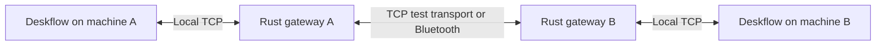
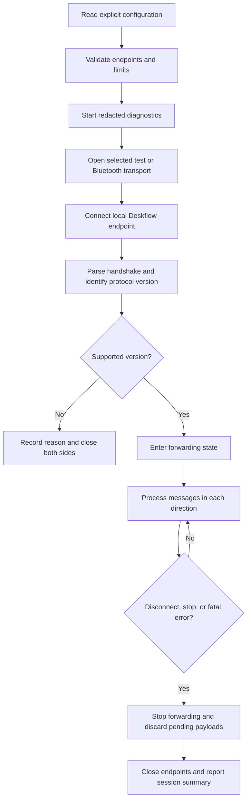
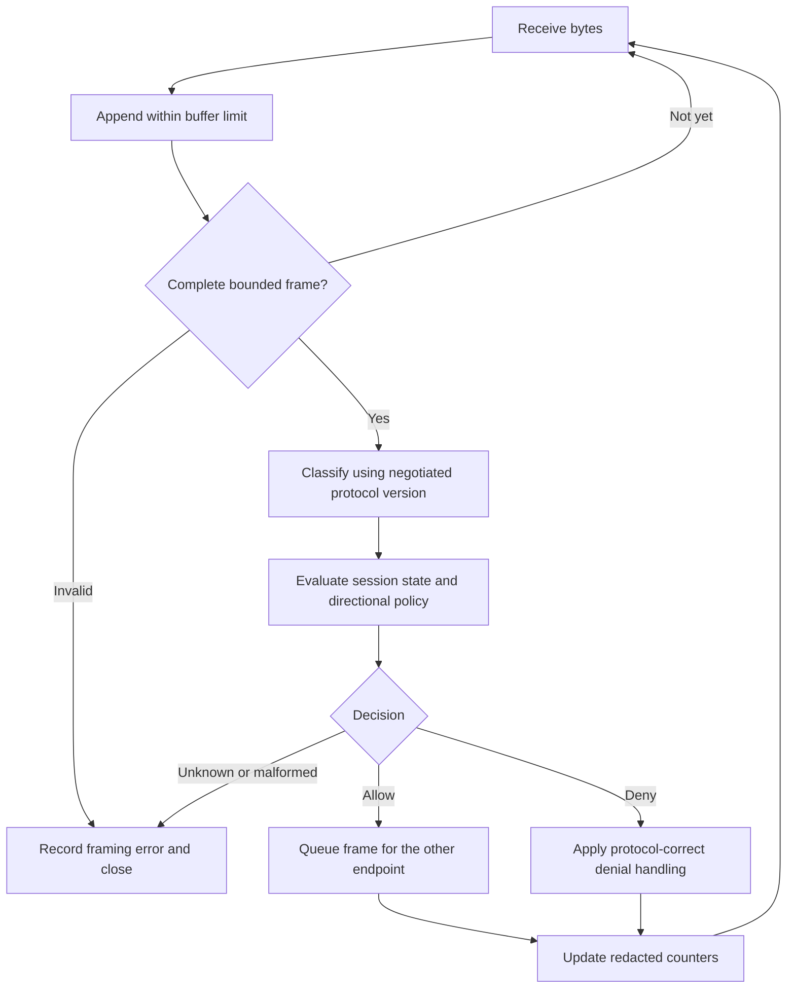

# Rust Deskflow Core: Process Flow And Working Plan

Status: draft for refinement, not an implemented system.
Last updated: 2026-10-22.

## 1. Purpose

Build a personal Rust-based Deskflow-compatible protocol gateway with optional
Bluetooth transport and directional clipboard restrictions. Start small enough
to learn Rust, test individual behaviors, and revise the architecture without
replacing Deskflow's OS-specific input implementation.

Upstream acceptance is optional. A maintainable personal fork is an acceptable
outcome. No compatibility, security, build, or runtime result is implied by this
plan.

## 2. Intended Setup

| Machine | Environment | Intended role |
| --- | --- | --- |
| Work laptop | Windows with VPN blocking local network traffic | Approved Bluetooth endpoint; deny outgoing clipboard content |
| Personal laptop A | COSMIC Wayland | Personal sharing endpoint; possible Bluetooth counterpart |
| Personal laptop B | COSMIC Wayland | Personal sharing endpoint |
| Mini PC | Bazzite, currently X11 | Personal sharing endpoint |

The physical keyboard/mouse owner and primary/secondary roles are still to be
chosen. These roles must not be confused with permission direction: "outgoing"
always means leaving the endpoint whose policy is being evaluated.

The work machine is currently for source review and isolated tests only. No
live Deskflow/Synergy connection is to be established there during this stage.
Do not change the VPN/firewall or introduce general LAN/internet routing.
Actual Bluetooth/input testing belongs in a separately agreed permitted setup.

The experimental COSMIC compositor/portal patches are a separate workstream.
This gateway does not supply missing Wayland desktop interfaces. X11-only
machines do not need those COSMIC patches.

## 3. Agreed Direction

- Use Rust for the new protocol/transport work.
- Retain Deskflow for OS input capture, injection, clipboard access, keyboard
  mapping, and desktop integration initially.
- Pin a Deskflow source/protocol baseline before implementing compatibility.
- Establish ordinary forwarding before depending on Bluetooth or filtering.
- Support useful debug logs without recording typed or copied content.
- Keep production-level policy administration, packaging, and certificate
  management outside the initial proof of concept.
- Treat the prototype as experimental, not a data diode or a proven security
  boundary.

Synergy 3.4.8 was the user's previously reported application version. That does
not establish its wire-protocol version. Initial compatibility should target
Deskflow; Synergy interoperability is a later, separately verified objective.

## 4. Proposed Architecture

The first candidate is a paired gateway, not a replacement input engine:



Proposed logical components, not yet Cargo crates or committed module APIs:

| Component | Responsibility |
| --- | --- |
| Framing/parser | Incrementally decode bounded frames and classify supported messages |
| Session state | Track handshake, negotiated version, connection state, and shutdown |
| Transfer policy | Decide whether a message may cross a particular direction |
| Transport | Provide ordered bytes, disconnect detection, and bounded queues |
| Diagnostics | Record redacted operational events and aggregate counters |
| CLI/configuration | Choose endpoints, transport, logging, and local policy |

An alternative is integration into Deskflow before protocol encryption, through
a narrow Rust/C++ interface. Revisit this if the external gateway requires too
much protocol rewriting or cannot meet the chosen TLS configuration.

## 5. Startup And Connection Flow



Local TCP listeners bind to loopback for the prototype. Do not silently open
them on all network interfaces. One connection is not automatically one complete
frame, and a read may contain part of a message or multiple messages.

Reconnect behavior should start a fresh session and handshake. Do not reuse
stale clipboard chunks, permission decisions, or queued input from an old session.
Automatic retry limits and delays are open decisions.

## 6. Per-Message Flow



For allowed traffic, preserve framing and ordering. Denial is not necessarily
equivalent to dropping a packet: clipboard ownership, requests, chunks, and
completion behavior must be understood together. If a safe denial behavior is
not known, stop the session rather than claim that filtering succeeded.

Choose explicit buffer, message-size, queue, and timeout limits before adding
live listeners. Use an established framing/parser library where suitable; do not
implement Bluetooth's underlying protocols from scratch.

## 7. Directional Transfer Policy

Initial desired clipboard policy:

| Path | Desired outcome |
| --- | --- |
| Personal to personal | Preserve ordinary clipboard sharing |
| Work to personal | Block clipboard contents of every supported type |
| Personal to work | Configurable; confirm whether allowed for the first trial |
| Required protocol/control replies | Allow only supported messages required for the session |
| Keyboard/mouse events | Allow for the selected trusted controller and session |

This is not a ban on all work-to-personal bytes. Protocol control traffic may
need to return, and input events themselves can carry information. Do not label
this a one-way network connection or claim prevention of all data leakage.

Tests must cover clipboard ownership announcements, content requests, text,
HTML, images, X11 selections, chunked content, canceled transfers, queued work,
and reconnects. Do not assume a clipboard-specific TCP port exists. Unknown
message types must not quietly bypass policy.

## 8. Debug Logging

Keep logs useful at `info`, `debug`, and `trace` without putting sensitive
payloads into the logging pipeline at any level. Do not log first and redact
later.

Allowed examples:

```text
session opened: transport=bluetooth
protocol negotiated: version=<supported-version>
input summary: category=keyboard forwarded=24 interval=10s
transfer blocked: category=clipboard direction=work-to-personal
session closed: reason=transport-disconnected
```

Exclude characters, keycodes, scan codes, modifier combinations, clipboard
contents, filenames, raw frames, pairing secrets, and private keys. Prefer
periodic input summaries to per-keystroke timestamps. Select final levels,
rotation, retention, and aggregate interval during implementation.

Use the synthetic phrase "my voice is my passport. Please, verify me." to check
delivery and exclusion from logs. A passing redaction test must also check for
encoded payload representations; absence of the literal phrase alone is not
enough. This phrase is test data, not an authentication secret.

## 9. Bluetooth And Encryption Decisions

Bluetooth transport is proposed, not yet selected. Compare compatible Windows
and Linux PAN support with a direct Bluetooth socket transport. A container
alone does not provide the missing Bluetooth connection.

For direct sockets, use maintained OS APIs/libraries and explicitly select the
paired peer. Verify authentication, Bluetooth link encryption, sustained input
latency, queue behavior, sleep/resume, and disconnect handling on real adapters.

An external gateway cannot classify end-to-end TLS ciphertext. The user has
reported using Synergy without application TLS, but Deskflow's actual test
configuration remains to be selected. Defer full certificate management, not
the decision about where plaintext is available. Record that decision before
claiming content filtering. Do not silently disable TLS or assume Bluetooth
pairing proves the required link encryption is active.

## 10. Staged Milestones

Milestone 1 has a dependency-free Cargo library that decodes a single bounded
length-prefixed frame using borrowed slices. A transport `FrameBuffer` now
accumulates fragmented/coalesced TCP reads while retaining at most one
incomplete frame. The in-memory session model now requires
a strict protocol-1.8 startup through QINF, DINF, CIAK, and DSOP before input.
EOF decoding now distinguishes clean closure from truncated headers/payloads,
while allowing complete frames to be drained before a partial tail is rejected.
An encoder now produces big-endian frames with checked lengths and caller limits.
All framing tests are active. Empty encoding requests and zero-length prefixes
are rejected as a deliberate stricter policy, rather than reproducing upstream's
ambiguous empty-envelope behavior. This has not been tested with live endpoints.
Complete server/client greeting parsing and pure role-specific version checks
are now implemented. Those checks do not enable forwarding, authenticate peer
names, or implement every accepted version's later message formats.
The session model adds generation isolation, logical two-endpoint shutdown,
encoded-byte-bounded output queues, and a small validated input/control subset.
The model now supports CCLP/DCLP under default-deny local send/receive permissions.
Denied transfers are consumed without queueing content; allowed frames preserve
bytes/order. Revocation purges unsent clipboard frames, or closes the session if
a start has already been drained. Permissions survive restart and remote options.
Unknown/malformed messages still close the model. This does not complete milestone
3: live ownership/timeout behavior and transport-level diagnostic non-delivery
remain unverified.
The diagnostics module now defines enum-only event records and deterministic
keyboard/pointer outcome summaries. A writer-backed logger formats only those
approved fields and returns sink errors. Session now buffers those typed records
for the caller to drain; sink I/O and formatting remain caller-owned. It records
session-open, protocol-negotiated, ready, clipboard-policy, rejection, close,
and restart events, and aggregates accepted/queue-denied keyboard and pointer
messages into ten-second summaries. Tests exercise redacted formatter output
from synthetic session traffic. The diagnostics queue is capped at 5,000
records and drops oldest records on overflow; `take_diagnostics` reports the
saturating dropped-record count. Callers should still drain regularly; this is
not a live logging pipeline. A loopback-only TCP bridge now connects two
already-established streams through `Session`, retaining partial writes and
shutting down both streams on closure/disconnect. It creates no listeners or
outbound connections. Five transport tests cover frame buffering, size/EOF
errors, and a synthetic protocol-1.8 handshake plus ordered traffic over local
TCP. `LoopbackForwarder` now binds two loopback-only listeners, accepts a peer
on each, and constructs a fresh session for each generation. Cancellation
handles stop accept waits and active forwarding, shutting down both streams and
returning a distinct result. Once Ready, the bridge applies Deskflow's pinned
three-missed-keepalive timeout: 3-second interval, 9 seconds without a complete
message. It forwards `CALV` but does not generate keepalive traffic. It does not
make outbound connections or retry automatically. Local safety deadlines cap
the total paired-peer accept window at 30 seconds, the post-connect handshake
at 30 seconds, and each incomplete frame at 10 seconds from its first byte.
These are configurable safeguards, not protocol requirements; each has a
distinct transport error and typed session close diagnostic. Thirteen transport
tests cover buffering, listener validation, forwarding, repeated sessions,
cancellation, idle timeout, and all three deadline types. Two compatibility tests now check exact upstream-documented hello,
DINF, DKDL, DKRP, DMDN, DMMV, DMRM, DMWM, CINN, COUT, CCLP, and DCLP examples
or formats, plus source-defined QINF, CIAK, CROP, and DSOP messages against the
pinned commit. A malformed fixed-width input fixture verifies the local session
closes instead of forwarding. The offline suite reports 59 passing tests and
three ignored placeholders. This small fixture set does not establish broad
compatibility; real-peer operability and additional independently checked
fixtures remain pending.

### Session diagnostics integration: implemented scope

Keep the session state machine independent of log formatting and payload bytes.
`Session::take_diagnostics(now)` drains typed `Event` records and any due
`InputSummary` into caller ownership. Do not pass raw frames, clipboard bytes,
key/button values, peer names, or arbitrary message strings to that consumer.
The caller can send those records to `LogRecorder`; sink I/O errors are returned
to the caller and do not change forwarding or policy outcomes.

The initial integration and queue bound are implemented and covered offline.
Verify the caller's drain/error-handling lifecycle before using it in any
long-running process. Current implementation and test scope:

- Session retains only typed, enum/numeric records and never invokes a writer.
- It emits lifecycle, negotiation, control, clipboard-policy, rejection, and
  close records; routine keepalive and individual input events are not logged.
- Input summaries use a ten-second injected monotonic `Duration` clock. Both
  the summary deadline and counts continue across a generation restart, so
  counts are neither lost nor duplicated; callers use one monotonic clock for
  the lifetime of the `Session` value. `Forwarded` counts mean accepted into
  the in-memory output queue, not transport delivery.
- When the 5,000-record queue is full, Session drops oldest records and reports
  the saturating loss count in the next drained batch. Callers should drain
  regularly and handle that loss signal.
- Tests drive allowed/denied clipboard transfers, malformed frames, queue
  overflow, disconnect/restart, and keyboard outcomes through Session. They
  inspect typed events and formatted output for payload/key-metadata exclusion.
- Persistent sinks, rotation/retention, Bluetooth, and real-peer behavior remain
  outside this work. The queue is bounded, but callers should drain it regularly.

| Milestone | Deliverable | Exit check |
| --- | --- | --- |
| 0. Protocol baseline | Pinned commit/version and message inventory | Confirm framing and handshake from source |
| 1. Rust parser and in-memory session library | Bounded decoder, handshake, state machine, policy, and redacted diagnostics integration; no live sockets | Offline tests cover frame boundaries, session lifecycle, policy outcomes, diagnostic event coverage, payload non-disclosure, and capped diagnostics with visible drop counts |
| 2. Local forwarding | Loopback-only paired listeners and session bridge (no outbound connector or automatic retry) | Synthetic peers complete handshakes and ordered messages through fresh sessions; cancellation, 9-second session liveness timeout, and local 30/30/10-second pairing/handshake/frame deadlines; real-peer operability remains pending |
| 3. Clipboard restrictions | Explicit directional policy | Blocked clipboard payloads never reach destination or logs; redacted policy outcomes may be recorded; input still works |
| 4. Bluetooth transport | One Windows/Linux pair | Same protocol tests plus adapter, latency, and reconnect checks |
| 5. Deskflow integration | One personal-machine pair | Input, screen switching, clipboard policy, lock/unlock, and disconnect tests |
| 6. Multi-machine trial | Two COSMIC laptops and Bazzite mini PC | Personal sharing preserved; sensitive endpoint restrictions independently verified |

Do not use milestone 2 or the in-memory policy as a proven sensitive-data boundary.
Live tests involving the work laptop require a separate explicit
decision and must respect the permitted Bluetooth-only arrangement.

## 11. Open Decisions

- Which machine owns the physical keyboard/mouse, and can its role change?
- Is personal-to-work clipboard content allowed, or is the first work profile
  input-only in both clipboard directions?
- Which additional message subset should the gateway forward? The session model
  currently requires negotiated 1.8 with a limited input/control list and locally
  filtered CCLP/DCLP transfers. Standalone compatibility functions retain upstream's broader
  version matrices, but the session does not implement legacy message formats.
  Source reference: `c1b19244a37bd238038ea2bf0ab56d9efc2de5d7` in Cargo metadata.
- Does the first deliverable remain an external gateway or become an embedded
  Rust library inside the Deskflow fork?
- Can PAN satisfy the approved setup, or is a direct socket transport needed?
- What Windows version, Linux distributions, and Bluetooth adapters are involved?
- What application-TLS configuration is used, and where can policy see plaintext?
- What are the initial limits, reconnect behavior, and log-retention settings?
- Which Rust libraries best fit parsing, asynchronous I/O, Bluetooth, and logging?

Next verify caller drain/error handling, expand independently checked wire
fixtures to cover additional message fields and boundaries, and clarify
live-endpoint prerequisites.
The clipboard model still needs real-peer ownership/timeout validation and
multi-peer provenance decisions. The bridge and endpoint runner have only synthetic loopback coverage; outbound
connectors, accept timeout policy, automatic retries, production queue tuning,
key-release recovery, and live protocol compatibility remain unverified. The
9-second liveness timeout applies only after Ready; handshake and partial-frame
deadlines are not separately configured. A bounded production logging sink
remains unimplemented.

## 12. Refinement Notes

When a decision changes, update the relevant section and record why below.
Separate a design assumption, an implemented behavior, and an observed test result.
Never mark a milestone complete solely because its code has been generated.

| Date | Decision or evidence | Status |
| --- | --- | --- |
| 2026-10-22 | Rust protocol/transport prototype, retaining Deskflow OS integration | Agreed direction |
| 2026-10-22 | Useful diagnostic logs without input or clipboard payloads | Agreed direction |
| 2026-10-22 | External paired gateway and milestone order above | Proposed; refine before implementation |
| 2026-10-22 | Cargo library added; first framing test failed before implementation and passed afterward; six framing checks pass, 25 tests ignored | Observed in Ubuntu WSL; no live compatibility test |
| 2026-10-22 | EOF truncation test failed before implementation and passed afterward; complete-frame draining and error precedence covered; ten tests pass, 24 ignored | Observed offline in Ubuntu WSL; no live compatibility test |
| 2026-10-22 | Encoder and zero-length policy tests failed before implementation and passed afterward; binary payload and encoder limit tests pass; fourteen tests pass, 22 ignored | Observed offline in Ubuntu WSL; empty envelopes deliberately rejected; no live compatibility test |
| 2026-10-22 | Three handshake tests failed before implementation and passed afterward; bounded greeting parsing and asymmetric version checks implemented; seventeen tests pass, 19 ignored | Observed offline in Ubuntu WSL; no session readiness, input gating, or live compatibility test |
| 2026-10-22 | Four session stubs failed before implementation and passed afterward; three extra boundary tests pass; 24 tests pass, 15 ignored | In-memory protocol-1.8 model only; strict startup, generation/queue isolation; no live transport or clipboard policy |
| 2026-10-22 | Seven clipboard stubs failed before implementation and passed afterward; three extra boundary tests pass; 34 tests pass, 8 ignored | Synthetic in-memory default-deny directional policy, strict chunk lifecycle, queue cutover, restart/stale-policy isolation; no live clipboard or diagnostic verification |
| 2026-10-22 | Six diagnostics tests active; two new tests cover writer-backed formatting, verbosity filtering, sink errors, and payload exclusion; 40 tests pass, 4 ignored | Enum-only event metadata, aggregate counters, and a writer-backed logger; no session integration, retention, or durable sink |
| 2026-10-22 | Session diagnostics integration selected as the next step before live transports | Decision; implemented in the following entry |
| 2026-10-22 | Session diagnostics integration implemented with typed event draining, ten-second input summaries, and four integration tests; 44 tests pass, 4 ignored | Offline synthetic session behavior only; 5,000-record cap reports drop counts; no production sink |
| 2026-10-22 | Expanded pinned-source protocol-1.8 fixtures across startup, keyboard, pointer, screen transitions, clipboard chunks, and malformed shapes; 53 tests pass, 3 ignored | Exact fixed bytes checked offline through framing and in-memory session; no live compatibility claim |
| 2026-10-22 | Added cancellable loopback accepts/forwarding and the pinned 3-second/9-second keepalive timeout; 56 tests pass, 3 ignored | Offline cancellation and idle timeout coverage; no handshake deadline or live-peer test |
| 2026-10-22 | Added configurable 30-second paired-accept and handshake deadlines plus a 10-second incomplete-frame deadline; 59 tests pass, 3 ignored | Deterministic short-duration tests cover all local safeguards; they are not Deskflow protocol requirements |

## 13. References And Provenance

See the [README](README.md) for Deskflow documentation links, license terms,
and the AI assistance declaration. This working plan was drafted with GitHub
Copilot from the user's requirements; it is not an upstream issue or PR text.

The local Deskflow checkout was initially inspected at commit
`c1b19244a37bd238038ea2bf0ab56d9efc2de5d7`. It is now pinned as the framing/handshake source
reference, not a fully validated Rust compatibility target. Keep the source pin, message
inventory, and tests aligned as the project evolves.