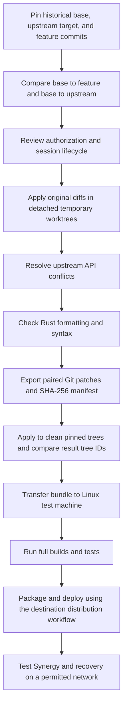

# COSMIC InputCapture Patch Bundle

Experimental source patches for the missing COSMIC Wayland InputCapture path
used by Synergy/Deskflow. Apply both patches together. These are not binaries
or distribution packages, and do not add clipboard or file-transfer protocols.
They are not needed on machines that continue to run an X11 desktop.

## Start Here On Linux

Extract `cosmic_input_capture.zip` and open a terminal in the extracted
`cosmic_input_capture` directory. Use a regular user account, not root.
Python 3.10+ and Git are required for preparation; Rust is needed only for builds.

```bash
python3 prepare.py verify
python3 prepare.py prepare --workspace "$HOME/src/cosmic-inputcapture-trial-01"
```

The preparation directory must not already exist. The script downloads fresh
source clones from the two official repositories, checks out the exact targets,
applies both patches, and checks the resulting Git trees against the manifest.
It does not modify an existing checkout, install dependencies, build anything,
start a service, change a firewall/VPN, or connect to Synergy.

After installing the native build prerequisites and appropriate Rust tooling
in your Linux development environment, explicitly request the build checks:

```bash
python3 prepare.py build --workspace "$HOME/src/cosmic-inputcapture-trial-01"
```

This runs formatting, Clippy, release tests, and a release build for each
project, stopping at the first error. Cargo can download dependencies and
execute dependency build scripts: this is not a sandbox. Nothing is installed,
even when every build command succeeds. Deploying both built components into a
COSMIC session is a separate, distribution-specific step.

## Process Flow

The bundle was created using this development sequence:



The script automates verification, source preparation, and the explicit build
checks. It does not automate security review, conflict resolution for newer
upstream commits, package compatibility decisions, deployment, or runtime tests.
Changing just a target SHA in the manifest is not a supported update procedure:
repeat the integration and regenerate/verify the patches and result tree IDs.

At runtime, the intended capture path is:

```mermaid
flowchart LR
		A[Synergy client] --> B[XDG portal frontend]
		B --> C[COSMIC portal backend: identity and consent]
		C --> D[Private compositor API: portal-owner authorization]
		D --> E[EIS connection: connected but inactive]
		E --> F[Enable arms capture]
		F --> G[Validated pointer barrier activates capture]
		G --> H[Physical input delivered over EIS]
		H --> I[Release, disable, lock, or disconnect stops delivery]
```



Both patches are required for that path. This diagram describes the intended
implementation, not a claim that all transitions have been runtime-validated.

## Logs And Agent Handoff

The preparation directory contains `compositor/`, `portal/`, `logs/`, and
`run-summary.json`. The summary records `prepared`, `built`, `failed`, or
`build-failed`, plus per-project progress and log locations. `built` means only
the scripted Cargo commands passed; it does not mean installed or runtime-safe.
Git preparation output and each Cargo step have separate logs.

```bash
cat "$HOME/src/cosmic-inputcapture-trial-01/run-summary.json"
ls "$HOME/src/cosmic-inputcapture-trial-01/logs"
```

On a preparation failure, keep the directory and logs for diagnosis. Correct
the underlying problem and choose a new empty preparation directory. The script
will not reset, delete, or automatically repair an existing directory. A failed
build may be retried with `build`, provided source verification still passes;
the checks run again from the beginning and logs are appended. If a build changes
tracked source or a lockfile, the next run refuses it rather than discarding it.

For an offline preparation, provide already-fetched local clones in a directory
containing subdirectories named exactly `compositor` and `portal`:

```bash
python3 prepare.py prepare \
	--workspace "$HOME/src/cosmic-inputcapture-offline-01" \
	--source-root /path/to/source-cache
```

Both target commits must exist in that cache. Preparation clones only committed
history; staged edits in a cache checkout are not copied. Cargo builds still
need cached/vendored dependencies or network access.

An agent can be given this handoff:

> Work as a non-root user. Read this README and manifest before acting. Run
> `python3 prepare.py verify`, then `prepare` into a new directory. Read the JSON
> summary and logs. Record OS, architecture, desktop/session type, and installed
> COSMIC package versions. Verify build prerequisites before explicitly running
> `build`. Stop on failures and report evidence; do not reset source, force patches,
> change target commits, install binaries, restart desktop services, alter the
> VPN/firewall, create commits, or push changes. A separate deployment decision is
> required after successful build checks.

The runner's regression tests use disposable Git repositories and mocked Cargo
commands; they require Python and Git, but no Rust, network, or Synergy access:

```bash
python3 -B test_prepare.py -v
```

## Exact Targets

| Repository | Target commit | Feature source |
| --- | --- | --- |
| pop-os/cosmic-comp | `8cb1802caada438bb5cc7670dfabdaca5fad0502` | PR #2853, `d618128f5434fa02af65e1ac08bfb728caa56830` |
| pop-os/xdg-desktop-portal-cosmic | `f448ddfb296bf7bb23517b24b2f532559a334a1c` | PR #369, `3fddb5a61c4f4655d331e98ac19d39dceeade8de` |

The portal target is the Epoch 1.11.0 version-update commit. The compositor
target is the previously selected snapshot, not an automatically moving master.
These source pins do not establish compatibility with an installed OS package.
Check the actual COSMIC/package versions on each destination before deploying.
Do not downgrade a running desktop just to match a patch target.

## Provenance And Port Changes

Original implementation: DennisFury's
[compositor PR](https://github.com/pop-os/cosmic-comp/pull/2853) and
[portal PR](https://github.com/pop-os/xdg-desktop-portal-cosmic/pull/369).
The compositor PR incorporates the cursor-hiding follow-up discussed there.
Existing source licensing and attribution remain applicable.

This compatibility port was prepared with GitHub Copilot. It preserves
upstream's `Option<HideReason>` cursor model, typed pointer-activity calls,
virtual-keyboard/IME routing, and `EiState` D-Bus initialization. Capture hiding
remains independent of ordinary idle/typing/touch hiding, and release resets the
cursor idle baseline. The portal changes applied without manual conflicts.
No commits or branches were created in either source repository.

The original broad saved input-consent behavior is unchanged. The earlier
capability-scoping test encodes a narrower policy and is not a release gate for
this bundle. The suspected old-EIS-callback/new-session race has not been
reproduced, fixed, or ruled out. Do not describe this bundle as security-audited.
Preserve the AI provenance if discussing or sharing this work upstream.

## Checks And Limitations

See `manifest.json` for SHA-256 patch hashes, exact target/source commits,
resulting Git tree IDs, and machine-readable check results.

Validation covers Rust 1.93 syntax/formatting of changed Rust files, Git
whitespace/conflict checks, and application to clean copies of the exact
targets with resulting-tree equality. It does not cover dependency resolution,
typechecking, Clippy, unit tests, linking, a running portal/compositor, or a
Synergy connection. The Windows work machine's VPN/firewall was not changed.
The automation has also been tested with temporary Git fixtures. Those runner
tests are distinct from the upstream projects' unit tests and Linux runtime tests.

## Transfer And Apply On Linux

The automated commands above are preferred. The following is the equivalent
manual source-application procedure for inspection or troubleshooting.

Transfer this entire directory, including the manifest, to a permitted machine.
Keep a separate known-good desktop/session and a tested recovery path. Do not
replace the currently running compositor or portal during initial testing.

Set `PATCH_DIR` to the absolute path of the transferred directory:

```bash
PATCH_DIR="$(realpath /path/to/cosmic_input_capture)"
sha256sum "$PATCH_DIR/"*.patch
```

Compare those hashes against the manifest obtained from your trusted copy.
The manifest is a checksum record, not a cryptographic signature.

Use fresh source clones, not your running desktop's installation directories:

```bash
git clone https://github.com/pop-os/cosmic-comp.git cosmic-comp-input-capture
cd cosmic-comp-input-capture
git checkout --detach 8cb1802caada438bb5cc7670dfabdaca5fad0502
git apply --check --index "$PATCH_DIR/cosmic-comp-input-capture.patch"
git apply --index "$PATCH_DIR/cosmic-comp-input-capture.patch"
git diff --cached --check
cd ..

git clone https://github.com/pop-os/xdg-desktop-portal-cosmic.git cosmic-portal-input-capture
cd cosmic-portal-input-capture
git checkout --detach f448ddfb296bf7bb23517b24b2f532559a334a1c
git apply --check --index "$PATCH_DIR/xdg-desktop-portal-cosmic-input-capture.patch"
git apply --index "$PATCH_DIR/xdg-desktop-portal-cosmic-input-capture.patch"
git diff --cached --check
cd ..
```

These are plain Git diffs: use `git apply`, not `git am`. Stop if any check fails;
do not force the patch onto a different revision or discard existing changes.

## Destination Validation

Treat the two destination machines independently. Record each machine's OS,
architecture, session type, and installed COSMIC package versions first:

```bash
cat /etc/os-release
uname -m
printf 'Session: %s\nDesktop: %s\n' "$XDG_SESSION_TYPE" "$XDG_CURRENT_DESKTOP"
```

Use the distribution's package query tools to record compositor and portal
versions as well. An X11 Bazzite machine does not need these patches merely to
communicate with another Synergy machine. If it later runs COSMIC Wayland, that
is a new compatibility/deployment assessment, not an automatic install target.

Install build prerequisites using the destination distribution's supported
development environment. Run each project's documented build and CI checks.
The compositor pins Rust 1.93 and needs its Linux development libraries. WSL's
standalone compiler used for review is not a complete COSMIC build environment.
At minimum, run the following inside each patched repository with a suitable
toolchain and its required native libraries:

```bash
cargo fmt --all -- --check
cargo clippy --release --all-targets -- -D warnings
cargo test --release
cargo build --release
```

With rustup, ensure the compositor's pinned `1.93` toolchain has rustfmt, Clippy,
and rust-src installed. The standalone WSL review installation is not rustup and
does not satisfy all of these requirements automatically. Native prerequisites
must match the destination: inspect the pinned projects' CI/build documentation
and use the distribution's supported development environment. Do not run an
unreviewed universal `sudo apt`/`dnf` installer or modify an image-based host just
to satisfy the script. Cargo's dependency resolution is not forced offline or
locked by this runner; retain the resulting lockfiles and logs for reproducibility.

Only after those pass, prepare distribution-appropriate packages or an isolated
test session. No installation method is prescribed here: Bazzite/image-based
systems and other distributions have different deployment/recovery procedures.

On a permitted COSMIC Wayland test machine, verify Synergy core startup,
Allow/Deny/Always Allow, pointer barrier transitions, keyboard/buttons/scroll,
lock/unlock, held keys/buttons across transitions, portal/client disconnects,
close/reconnect, monitor changes, cursor restoration, and the clipboard types
your Synergy version supports. Clipboard behavior must be checked separately;
these patches do not prove it works. Retain logs without recording typed input.

Before deployment, establish how to select a known-good login session and restore
the distribution's original compositor and portal packages. Retain the original
packages or supported image rollback path. On failure, return to that known-good
session and use the distribution's package recovery mechanism for both components.
Do not improvise recovery by deleting desktop binaries or changing firewall rules.